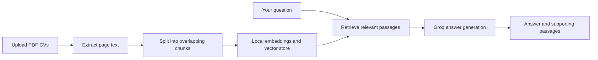

# CV Insight — Multi-CV RAG Assistant

A Python application for asking questions about one or more PDF CVs using
Streamlit, LangChain, and Groq. Explore experience, compare skills, and categorize
job titles from retrieved CV passages, with source references you can inspect.

PDF loading, text splitting, local embeddings, and semantic search are implemented.
Groq generates answers from the retrieved passages with requested page citations.

## Features

- Upload multiple PDF CVs in a Streamlit interface.
- Ask about all uploaded CVs or focus on a single document.
- Generate answers using `openai/gpt-oss-120b` through Groq.
- Inspect supporting passages with CV names and page numbers.
- Generate embeddings locally with FastEmbed and search an in-memory vector store.
- Use the command-line interface for PDF previews, retrieval, and answers.

## How it works



The application uses retrieval-augmented generation (RAG); it does not train or
fine-tune the language model on uploaded CVs.

## Example questions

- What Python experience is mentioned in this CV?
- Which uploaded CVs mention SQL, and in what context?
- Categorize the job titles found in the retrieved CV passages.
- Compare the cloud technologies mentioned in these CVs.

## Requirements

- Python 3.10 or newer (tested locally with Python 3.13).
- A Groq API key with access to the configured model for answer generation.
- Internet access for Groq requests and the initial embedding-model download.

PDF extraction, embeddings, and search run locally. Groq usage is subject to
your account's available quota and limits.

## Setup (PowerShell)

Requires Python 3.10 or newer. Run from the project directory:

```powershell
python -m venv .venv
.\.venv\Scripts\python.exe -m pip install -e .
Copy-Item .env.example .env
.\.venv\Scripts\resume-checker.exe --help
```

Activation is optional; these commands use the virtual environment directly.
If `.env` already exists, keep it instead of copying the example over it.

## Project structure

```text
src/resume_checker/   Python application
streamlit_app.py      Streamlit upload and question interface
tests/               Backend and Streamlit behavior tests
data/                Local CVs and PDFs (ignored by Git)
.env.example         Groq configuration template
pyproject.toml       Package metadata and dependencies
```

## Streamlit interface

Start the UI from the project directory:

```powershell
.\.venv\Scripts\python.exe -m streamlit run streamlit_app.py
```

Open `http://localhost:8501`, upload one or more PDF CVs, and click **Prepare CVs**.
Ask questions across **All CVs** or select a single file. Answers have expandable
supporting passages with file names and page numbers. Each question is independent;
the displayed conversation is not sent as context for follow-up questions.

The app uses your existing `.env` Groq settings. Each selected CV contributes up
to two relevant passages; answers may miss information outside those passages.
Uploads are limited to 20 MB per file. Scanned PDFs still require OCR.

Indexes and chat are kept per browser session, not shared between users. Changing
uploads resets both. Temporary PDF files are removed after extraction. Embedding
model weights are cached on disk; CV indexes are not persisted. Relevant passages
are sent to Groq when you ask a question.

## Command-line interface

Put a text-based PDF in `data/`, then run:

```powershell
.\.venv\Scripts\resume-checker.exe "data/cv.pdf"
```

You can also run the Python module:

```powershell
.\.venv\Scripts\python.exe -m resume_checker.main "data/cv.pdf"
```

The app prints the page count, extracted character count, chunk count, and up to
300 characters from the first five chunks. Full chunks remain in memory for the
next RAG steps. Preview mode does not embed or save them. No API key is required. Scanned PDFs need
OCR, which is not supported yet; password-protected PDFs are also unsupported.

The loader uses LangChain's
[PyPDFLoader](https://reference.langchain.com/python/langchain-community/document_loaders/pdf/PyPDFLoader)
in page mode.

## Text splitting

LangChain's [RecursiveCharacterTextSplitter](https://reference.langchain.com/python/langchain-text-splitters/character/RecursiveCharacterTextSplitter)
splits each page into chunks of at most 1,000 characters, with a target overlap
of 200 characters. It prefers paragraph and word boundaries; actual overlap can
be smaller. Chunks never cross pages and keep source, page, and start-index metadata.
Blank pages are skipped. Sizes count characters, not tokens.

Override the defaults with:

```powershell
.\.venv\Scripts\resume-checker.exe "data/cv.pdf" --chunk-size 800 --chunk-overlap 150
```

## Search your PDF

```powershell
.\.venv\Scripts\resume-checker.exe "data/cv.pdf" --question "What Python experience does this candidate have?" --top-k 3 --search-only
```

This uses LangChain's [FastEmbedEmbeddings](https://reference.langchain.com/python/langchain-community/embeddings/fastembed/FastEmbedEmbeddings)
with `BAAI/bge-small-en-v1.5` (an English embedding model), and an
[InMemoryVectorStore](https://reference.langchain.com/python/langchain-core/vectorstores/in_memory/InMemoryVectorStore).
The embedding model runs locally on CPU. Its weights download on first search
and are cached in `.cache/fastembed/`. Internet access is needed for this initial
download, but no API key is needed and PDF text is not sent to an LLM.

Each run rebuilds the index in memory. Results include full chunk text, source,
and page number. Search always returns the closest available chunks (up to
`--top-k`), even if the PDF does not answer the question. Search-only mode does
not generate answers or decide whether the evidence is sufficient.

## Generate answers with Groq

Set these values in the project's `.env` file:

```dotenv
LLM_PROVIDER=groq
LLM_MODEL=openai/gpt-oss-120b
GROQ_API_KEY=your_key_here
LLM_MAX_TOKENS=8192
LLM_REASONING_EFFORT=low
```

`GROQ_CHAT_MODEL` is also accepted when `LLM_MODEL` is empty or unset. If both
are empty, the model defaults to `openai/gpt-oss-120b`. The project `.env` is read
on each question and takes precedence over process environment values, so edits
apply without restarting the app.

The completion budget defaults to 8,192 tokens. GPT-OSS reasoning also uses
completion tokens; low reasoning effort leaves more room for the answer.
Answers target 700 words and categorization uses compact tables. This is a
prompt target, not a guaranteed length. Higher budgets can consume more quota.

```powershell
.\.venv\Scripts\resume-checker.exe "data/cv.pdf" --question "What Python experience does this candidate have?"
```

The app uses LangChain's [ChatGroq](https://reference.langchain.com/python/langchain-groq/chat_models/ChatGroq).
It sends the question and retrieved passage text to Groq, then prints the answer
and supporting passages. Local file paths and the API key are not included in
the prompt. The model is instructed to cite `[Passage N, page P]`, use only the
provided evidence, and acknowledge missing information. Citations and factual
accuracy are not automatically verified; compare the answer with the printed
passages. Groq requests use your account's quota.

The embedding model has a 512-token input limit; unusually dense text or large
custom chunks can be truncated when embedded. Start with the default chunk size.

Run the retrieval integration checks (downloads the model if not cached):

```powershell
.\.venv\Scripts\python.exe -m unittest discover -s tests -v
```

## Current limitations

- Only text-based PDFs are supported; OCR and password-protected PDFs are not.
- The UI retrieves up to two passages per selected CV. Broad requests such as
  listing every job title may miss information outside those passages.
- Questions are independent; previous chat messages are displayed but are not
  used as model context.
- Indexes are temporary and must be rebuilt after the session ends.
- The embedding model is designed for English text.
- Model answers and citations can be incorrect and should be checked against
  the supporting passages.

## Development ideas

Possible extensions include complete-document title extraction, conversational
follow-up questions, persistent indexes, OCR, and downloadable comparison reports.
These are not implemented features.

Keep API keys in `.env` and personal documents in `data/`; both are ignored by Git.
